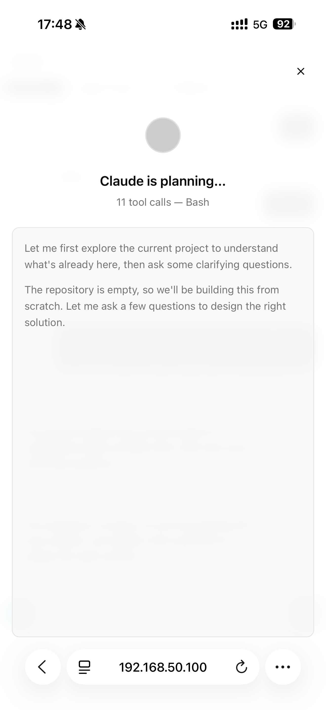
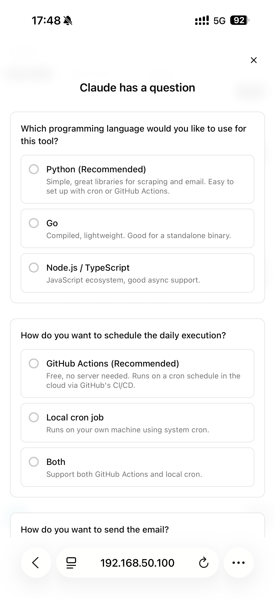
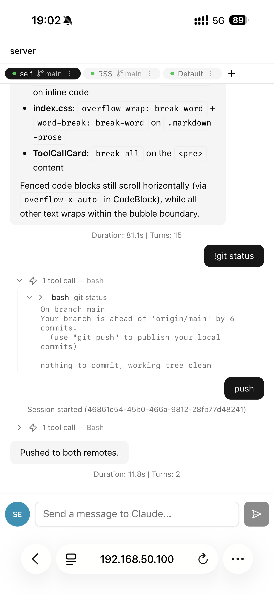

# Gate

[English](README.md) | [中文](README_CN.md)

**Gate** opens a portal to AI coding CLIs ([Claude Code](https://docs.anthropic.com/en/docs/claude-code), [OpenAI Codex](https://github.com/openai/codex)) on remote servers — code from anywhere, on any device.

Waiting in line, on the couch, on the train — pull out your phone and pick up right where you left off. Gate bridges your browser to CLI sessions over SSH, so your coding environment is always one tap away.

```
Browser (React) <--HTTP/WebSocket--> Node.js Backend <--SSH--> Remote Server
                                     |
                              Provider Layer
                              Claude / Codex / ...
```

## Example

<table align="center">
  <tr>
    <td align="center"><br/><em>Planning mode</em></td>
    <td align="center"><br/><em>Interactive questions</em></td>
  </tr>
  <tr>
    <td align="center"><br/><em>Chat with Claude</em></td>
    <td align="center"><br/><em>Command execution</em></td>
  </tr>
</table>

## Key Features

- **Task workbench** — The default Overview groups independent tasks by delivery status. Projects can have working
  copies on multiple machines; each task keeps its own goal, acceptance criteria, agent choice, and execution history.
  The Sessions entry preserves access to existing workspace chats. Managed tasks run independently through a remote
  runtime, with replay after backend/SSH reconnect, isolated worktrees, and confirmed stop status.
- **Decisions and evidence** — Resolve agent questions and supported approvals from the attention-first Overview.
  Codex approvals expose the offered Allow/Decline/Cancel choices; a canceled turn stays interrupted until confirmed exit.
  Run test commands, inspect changes, and compare recorded evidence with the checkout's code snapshot.
  Task acceptance stays explicit; test success does not automatically mark work done.
- **Project defaults and scripts** — Choose the default agent, working copy, and isolation for new tasks.
  Preview and run setup/run/test commands from `gate.json` or project overrides, with durable output and exit status.
  Setup and run records stay separate from test evidence.
- **Task delivery** — Preview the branch and code version, commit inspected changes, push that commit to origin,
  and create or reuse a draft GitHub PR. Each operation has its own durable run and recorded commit/PR result.
- **Handoff and independent review** — Continue with another agent using recorded context and test evidence.
  Review a fixed snapshot in a separate checkout while task work continues, and see when that review becomes stale.
- **External session awareness** — Install checkout-scoped Claude/Codex hooks to see native session activity and link it
  to tasks. Shared-checkout conflicts stay visible; native sessions remain controlled in their original terminals.
- **Persistent native terminals** — Open a shell or native coding CLI in a task, attach from the browser, resize it,
  and reconnect after closing the page. One browser controls input at a time. Remote terminals require Linux and Python 3.9+.
  Native Codex terminals require `--no-daemon` support so their execution stays owned by the terminal runtime.

- **Code from anywhere** — Start on your desktop, pick up on your phone. Sessions persist across devices via SSH and CLI resume.
- **Resume saved conversations** — Find a CLI transcript and resume its conversation. This starts a new process;
  it does not attach to a process already running in another terminal.
- **Clean chat UI** — Terminal output parsed into markdown messages, collapsible tool cards, syntax-highlighted code blocks, and scrollable tables.
- **Multi-server, multi-session** — Manage several remote servers with multiple sessions each. Swipe or tap to switch.
- **Workspace command center** — Repositories are first-class workspaces grouped by backlog, in-progress, review, done, or canceled status. Pin, archive, and continue work without opening every chat.
- **Simple workspace overview** — Each workspace shows a focused start composer, visible session list, server/branch/worktree summary, changed-file count, and on-demand tools.
- **Workspace start flow** — Start from a prompt, choose Claude or Codex, and use the current branch, switch branches, create a new branch, or choose a current/new/existing worktree before the CLI starts.
- **Workspace inspector** — A fixed, on-demand right sidebar for changes, plans, repo scripts, one-shot terminal commands, and delivery actions.
- **Repo scripts and delivery actions** — Optional `gate.json` scripts (`setup`, `run`, `test`) can run over SSH; generate commit messages, commit and push, push, create PR, and mark review/done/canceled from the workspace inspector.
- **Live plan tracking** — Checklists auto-extracted from Claude's output into a side panel. Check off steps, edit plans, send them back for execution.
- **Transcript sync** — Catch up on work done outside Gate by syncing the transcript from the remote CLI session.
- **Responsive tasks** — Execution and results share two columns on desktop. Mobile section controls reach execution,
  results, and delivery directly; recent evidence stays visible with older records expandable.
  Existing chat views retain their drawers, bottom sheets, and swipe gestures.
- **Multi-CLI support** — Works with Claude Code and OpenAI Codex CLI. Switch between CLI tools within a session with automatic context sync. Provider sessions are preserved — switching back resumes your previous conversation, not a new one.
- **Switch Chat** — Start a fresh CLI conversation or resume a previous one within the same session. Messages are scoped per CLI session so switching gives you a clean view.
- **Persistent history** — SQLite-backed chat history survives reconnects and server restarts.

## Quick Start

### Prerequisites

- Node.js >= 20
- A remote server with SSH access and at least one of:
  - [Claude Code CLI](https://docs.anthropic.com/en/docs/claude-code) — run `claude` once on the server to complete authentication
  - [OpenAI Codex CLI](https://github.com/openai/codex) — run `codex` once on the server to complete authentication

### Install via npm (recommended)

```bash
npm i -g @marukohe/gate
gate
```

Open `http://localhost:3030` in your browser. Data is stored in `~/.gate/`.

CLI options:

```bash
gate --port 8080          # custom port (default: 3030)
gate --host 127.0.0.1     # bind address (default: 0.0.0.0)
gate --data-dir /my/data  # custom data directory (default: ~/.gate)
```

### Add a Server

Open the app → click **Add Server** → fill in your SSH credentials (password or private key). Set a default working directory for new sessions.

## Development

The task workbench refactor is tracked in [the implementation plan](docs/refactor-plan.md), with completed checks
and scope in the [acceptance record](docs/workbench-acceptance.md).
Contributors should read [LESSONS.md](LESSONS.md) before making changes and record verified problems there.
Each completed refactor step is validated and committed separately.
The [runtime feasibility probe](tools/runtime-probe/README.md) checks independent execution and replay over SSH.
It uses isolated fixtures against the runtime shipped in `server/runtime/`.
See [managed execution](docs/managed-execution.md) for setup, guarantees, and validation limits.
Existing Sessions continue using the legacy backend connection path.
The new task model is stored alongside legacy workspaces and sessions. Migration preserves existing chat history
and imports explicit workspace goals once; ambiguous sessions remain available in the legacy workspace views.

### Setup

```bash
git clone https://github.com/Marukohe/Gate.git gate
cd gate
npm install
npm run dev
```

The client runs on `http://localhost:5173` (proxies API/WS to the server on port 3030).

### Scripts

| Command | Description |
|---------|-------------|
| `npm run dev` | Start client + server in parallel |
| `npm run dev:client` | Vite dev server only (port 5173) |
| `npm run dev:server` | Express + WS server only (port 3030) |
| `npm run build` | Build both client and server |
| `npm run start` | Start production server |
| `cd server && npx vitest run` | Run server tests |
| `cd server && npx tsc --noEmit` | Type-check server |

## Project Structure

```
gate/
├── client/                      # React frontend
│   └── src/
│       ├── components/
│       │   ├── chat/            # ChatView, SessionBar, MessageBubble, ToolActivityBlock,
│       │   │                    # ChatInput, ProviderSwitcher, ResumeChatDialog, BranchSwitcher
│       │   ├── layout/          # AppShell, Sidebar, TopBar
│       │   ├── plan/            # PlanPanel, PlanStepItem
│       │   ├── plan-mode/       # PlanModeOverlay, PlanModeQuestion, PlanModeThinking
│       │   ├── server/          # ServerDialog
│       │   ├── workspace/       # WorkspaceHome, WorkspaceStart, WorkspaceInspector, WorkspaceActionBar
│       │   └── ui/              # shadcn/ui components
│       ├── hooks/               # use-websocket, use-swipe
│       ├── stores/              # Zustand stores (server, session, chat, git, plan, workspace, ui)
│       └── lib/                 # Utilities (plan-parser, provider-colors, server-utils, notification)
├── server/                      # Node.js backend
│   └── src/
│       ├── index.ts             # Express entry point
│       ├── db.ts                # SQLite (servers, sessions, messages)
│       ├── ssh-manager.ts       # SSH connection pool + CLI channel management
│       ├── ssh-browse.ts        # Remote directory browsing
│       ├── repo-scripts.ts      # Optional gate.json script parsing
│       ├── git-utils.ts         # Git command helpers
│       ├── workspace-actions.ts # Workspace delivery action state
│       ├── workspace-inspector.ts # Workspace inspector snapshots
│       ├── ws-handler.ts        # WebSocket server
│       ├── routes/              # REST API
│       ├── providers/
│       │   ├── types.ts         # CLIProvider interface, OutputParser, ParsedMessage
│       │   ├── registry.ts      # Provider registration and lookup
│       │   ├── claude/          # Claude Code CLI provider
│       │   └── codex/           # OpenAI Codex CLI provider
│       └── __tests__/           # Vitest test suites
└── docs/                        # Design documents
```

## Tech Stack

**Client:** Vite · React 19 · TypeScript · Tailwind CSS · shadcn/ui · Zustand

**Server:** Express 5 · ws · ssh2 · better-sqlite3 · TypeScript

**Testing:** Vitest

## WebSocket Protocol

Client → Server:
```jsonc
{ "type": "connect" | "input" | "disconnect", "serverId": "...", "sessionId": "...", "text": "..." }
{ "type": "switch-provider", "serverId": "...", "sessionId": "...", "provider": "codex" }
{ "type": "reset-conversation" | "resume-cli-session", "serverId": "...", "sessionId": "...", "claudeSessionId": "..." }
{ "type": "list-cli-sessions", "serverId": "...", "workingDir": "...", "provider": "claude" }
{ "type": "exec", "serverId": "...", "sessionId": "...", "workspaceId": "...", "command": "git status", "terminal": true, "requestId": "..." }
{ "type": "list-workspaces" | "create-workspace" | "update-workspace" | "delete-workspace", "workspaceId": "...", ... }
{ "type": "start-workspace-task", "workspaceId": "...", "goal": "...", "provider": "claude", "branchMode": "create", "worktreeMode": "isolated" }
{ "type": "fetch-workspace-inspector" | "run-workspace-script" | "run-workspace-action", "workspaceId": "...", ... }
```

Server → Client:
```jsonc
{ "type": "message" | "status" | "history" | "sessions" | "git-info", "serverId": "...", ... }
{ "type": "cli-sessions", "serverId": "...", "sessions": ["..."] }
{ "type": "exec-result", "workspaceId": "...", "requestId": "...", "stdout": "...", "stderr": "...", "exitCode": 0 }
{ "type": "workspace-list" | "workspace-update" | "workspace-deleted" | "workspace-task-started", "workspaceId": "...", ... }
{ "type": "workspace-inspector" | "workspace-run-result" | "workspace-action-result", "workspaceId": "...", ... }
```

## Responsive Layout

| Breakpoint | Layout |
|------------|--------|
| Desktop (≥1024px) | Tasks: execution and results side by side. Sessions: sidebar + chat + on-demand inspector |
| Tablet (768–1023px) | Tasks: stacked sections with direct navigation. Sessions: sidebar/inspector as drawers |
| Mobile (<768px) | Tasks: stacked sections, current evidence before history. Sessions: fullscreen chat and bottom sheets |

## Why "Gate"?

Named after *Steins;Gate* — the anime where messages travel through time to change the worldline. Here, your messages travel through SSH to reach Claude on a remote server, opening a gate between any device and your coding environment.

## License

MIT
