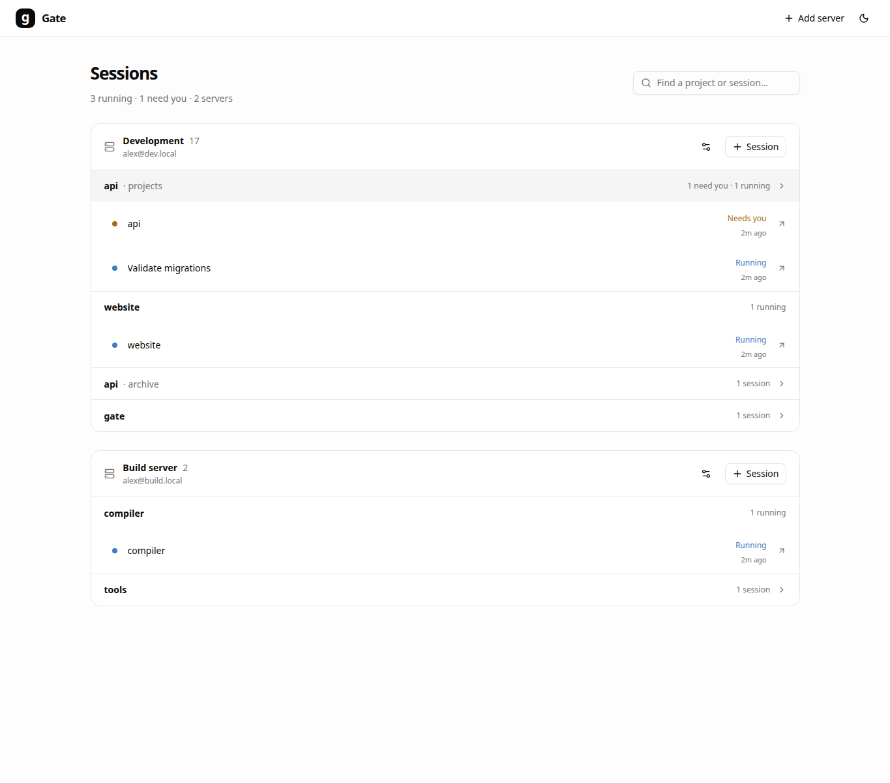

# Gate

[English](README.md) | [中文](README_CN.md)

Gate is a simple panel for coding-agent sessions across SSH servers, supporting **Codex** and **Google Antigravity CLI (agy)**.
See what needs attention, open conversations, and continue work from your browser.



## How it works

Each connection chooses a tool and an SSH account. The tool owns its sessions, history and execution;
Gate provides the panel, messages, approvals and interruption controls. There is no Gate remote runtime,
task orchestration, hook observer, transcript scanning or per-message CLI process.

| Tool | Connection | Session behavior |
| --- | --- | --- |
| Codex | Native shared app-server, with SSH Unix socket forwarding | Shares live terminal sessions. Closing Gate leaves Codex running. |
| Antigravity (agy) | One persistent `agy acp` process over SSH | Lists and loads native conversations. Live state and approvals cover work started through this connection. Disconnecting may interrupt that work; other terminal processes are untouched. |

Antigravity's ACP interface does not report other terminal clients' live activity or provide session rename/steering.
Saved sessions are historical entries, not proof that a terminal is idle. Avoid concurrent input to the same conversation
from different clients. Gate hides unsupported controls; a new agy message waits until the current turn ends or is stopped.

Gate routes connection actions through a small backend interface. Native protocol handling belongs to the tool adapter;
SSH access, repository grouping and the browser panel remain independent of it.

## Get started

1. Install Node.js 20+ on the machine running Gate.
2. Install and sign in to your chosen tool on the SSH server:
   - Codex with `codex app-server daemon` support (tested with 0.171.0).
   - [Antigravity CLI with ACP](https://antigravity.google/docs/ide/extensions/acp/) (tested with agy 1.5.16).
     Run `agy acp --login` on that server if you have not signed in.
3. Install the npm package from the latest [GitHub Release](https://github.com/Marukohe/Gate/releases/latest) and start Gate:

   ```bash
   npm install -g https://github.com/Marukohe/Gate/releases/latest/download/gate.tgz
   gate
   ```

   If you have access to the repository's [GitHub Packages](https://github.com/Marukohe/Gate/packages), you can install
   by package name. Log in once with your GitHub username and a classic personal access token with `read:packages`:

   ```bash
   npm login --scope=@marukohe --registry=https://npm.pkg.github.com --auth-type=legacy
   npm install -g @marukohe/gate
   gate
   ```

4. Open `http://localhost:3030` and choose **Add server**. Select an existing **SSH host** from `~/.ssh/config`
   on the machine running Gate, or choose **Enter manually…**. Select **Tool** and save.
   Importing fills the name, host, port, username and first available identity-file path; expand the connection summary
   to edit these fields or switch to password authentication. Passwords must be entered separately.
   Set **Tool executable** to an absolute path if it is not on the SSH login PATH.
   Add each tool's connection to use Codex and agy on the same machine; the sidebar combines them under one server.
   Existing Codex settings migrate automatically.

Run `gate update` to upgrade your global npm installation from the latest stable GitHub Release.
Use `gate --version` to check the installed version, and restart Gate if it is running to load the update.
For versions without `gate update`, use the installation command above to upgrade.

SSH import requires local OpenSSH. It lists concrete `Host` aliases, including `Include` files, and uses `ssh -G`
to resolve their settings. Gate saves an editable copy, does not change `~/.ssh/config`, and does not track later config edits.
ProxyJump, ProxyCommand and certificate-based configurations cannot be imported as direct connections; use manual settings
for a directly reachable server. Imported fields use Gate's existing key/password SSH connection, not every OpenSSH option.

For Codex, Gate connects to the native daemon, starting it if necessary without restarting an existing backend.
The SSH server must allow Unix socket forwarding. No public Codex port is required.
Use the same remote OS user and Codex configuration as your terminal.

## Everyday use

- **Sidebar:** servers, search, status filters, new sessions and connection settings live in one collapsible sidebar.
  Open a session beside it without leaving the list. The current session is highlighted; rows show a status dot, name
  and tool tag. Collapse with the top-left panel button; the desktop preference survives reload. On mobile the list uses
  the whole pane and closes when you choose a session. Search, filters and expanded groups stay while switching sessions.
  Drag either sidebar's inner edge to adjust its width; each width survives reload. Double-click the edge to reset it,
  or focus it and use the arrow keys. Narrower windows temporarily limit widths to leave room for the conversation.
- **Monitor:** the sidebar groups sessions by server and repository. Worktrees share their repository group.
  Connections with the same SSH host and port share one group, including sessions from different tools in the same repository.
  Each session name has a tool tag: green for Codex, purple for Antigravity, in both themes.
  The **Servers** count reflects these server groups, not the number of tools.
  Projects needing attention come first. Groups containing an active or current session start expanded; others start collapsed.
  An expanded group shows all its visible sessions, including idle/saved sessions from every tool.
  Click a project heading to expand or collapse the entire list.
  Full paths appear on hover, with short parent paths shown only for duplicate project names. Search reveals matches.
- **Quick filters:** click **Running** or **Needs you** to show matching sessions, grouped by server and repository.
  Click the selected filter again to show all sessions. It stays selected while you switch conversations.
- **Conversation layout:** one compact header contains the sidebar button when collapsed, the session name, and status counts.
  Click the name for server, directory, full status, rename, theme, or the session list.
  Mobile status buttons use icons and counts to leave room for the title.
- **Session status:** while chatting, the header shows other sessions needing attention and all running sessions,
  including the current conversation. The running list marks it **Current**. Click either count
  to switch sessions. New waits and native session errors show a brief notice with the server and reason.
  Opening or dismissing a notice leaves pending work in the list until its state changes.
  After switching, the back arrow returns to the original conversation; the forward arrow opens the next pending one.
  Drafts, model/effort choices, and reading positions stay
  in browser memory while the page remains open; reloading clears them.
- **Filter:** use the filter icon beside a server. Search **Available directories** and click **Hide**.
  If the server has multiple tools, select **Tool** in the dialog. Each tool keeps its existing filters and archives.
  **Blocked directories** stays collapsed; expand it and click **Show** to unblock a path.
  Use **Add another directory** for a custom parent path.
  Saved rules include existing and future descendants and match session working paths.
- **Archive:** use the archive icon on a session to hide it in Gate. Restore it under **Session filters → Archived sessions**.
  Filtering and archiving affect this Gate only; running sessions continue.
- **Continue:** open a session to read history and send messages. Codex also accepts updates during a running turn.
  Scroll up to load earlier messages automatically without losing your reading position. **Earlier messages** also
  works for manual loading. If loading fails, click it to retry; scrolling does not keep retrying the failed request.
  Scrolling up pauses automatic following; scroll back down near the bottom to follow new output again.
  History loads in place; background refreshes preserve newer live output received during the request.
- **Attach images:** click the image button beside the input or drop images onto the composer. Copy an image or screenshot
  and press **Ctrl+V** (**⌘V** on macOS) in the conversation to attach it, even without focusing the input first.
  Pasting adds a preview and focuses the input so you can type a description; it does not send the message.
  Review thumbnails and remove attachments before sending; text is optional. Supports PNG, JPEG, WebP and GIF,
  up to 4 images, 5 MB each and 10 MB total per message. Unsent attachments survive session switching in this tab;
  page reload clears drafts. Click a sent image to enlarge it. Codex restores images from native history;
  agy 1.5.16 accepts images but omits them when replaying saved history, so they disappear after the tool connection resets.
  Remove attachments before using a `!` shell command.
- **Files and images:** local Markdown links open files from the session's server in a new tab, including line references
  such as `main.ts:42` or `main.ts#L42`. Relative paths use the session's working directory; local images display inline.
  Gate reads through the existing SSH connection (SFTP), up to 10 MB per file. Text up to 1 MB is previewed; other files download.
- **File sidebar:** click the panel icon at the top right of a conversation to browse its server's files, starting in
  the session's working directory. Open folders, go up, return home, enter a path, or refresh. Click a file for a read-only
  text/image preview, with buttons to open a new tab or download. Each directory shows up to 1,000 entries.
  Text shows source line numbers; **Wrap lines** toggles automatic wrapping and remembers the choice in this browser.
  Markdown (`.md`, `.markdown`) and HTML (`.html`, `.htm`) offer **Source / Preview** in the file header.
  Markdown renders headings, tables, code and images. Relative links/images resolve beside the file.
  HTML shows a sandboxed static page with inline CSS and images; scripts, forms, embedded pages and external stylesheets
  are disabled. Switching views reuses the loaded file; opening a new tab and downloading still use the original source.
  The pane follows the selected session; its last directory/file stays in tab memory. Narrow windows temporarily hide
  the session list; phones show files full-screen. Closing it returns to the conversation with drafts and reading position intact.
  Browsing uses SFTP for both tools and does not send a model request.
- **Shell:** send `!pwd`, `!git status`, or another `!command` to execute directly through SSH in the session's working
  directory, without model inference. Results show stdout, stderr, and exit status; they survive switching sessions but
  clear on page reload and are never added to model context. Each command uses a fresh, non-interactive shell, with a
  60-second wait limit and up to 128,000 output characters. Directory/environment changes do not carry to later commands.
- **Model and reasoning:** select a model and its supported reasoning effort above the message input before a new turn.
  Choices and default efforts come from that tool's native catalog. Changes take effect when the message is sent
  and become the session defaults; running turns keep their current settings.
- **Rename (Codex):** click the conversation title, then **Rename**. Names are saved in Codex and shared with the terminal.
- **Start:** click **+** beside a server, choose a tool when more than one is configured, then enter
  a working directory and first instruction.
  This creates a native session in the chosen tool. The server's settings button likewise lets you select which tool to edit.
- **Respond:** allow/decline the tool's requested operations in the conversation. Codex also supports structured questions;
  unsupported Codex requests remain visible for handling in its terminal.
- **Interrupt:** stop the current turn without closing the tool connection.

For Codex, Gate controls sessions through the connected shared backend. It cannot attach to a separate
`codex --no-daemon` process. Missing connections show an error; uncertain writes are never resent automatically.
See [session behavior](docs/session-monitor.md) for status and connection details.

Gate is intended for trusted internal networks and has no authentication.
SSH settings, directory filters, and Gate archives are stored in `~/.gate/gate.db`; passwords are not returned to the browser.
Display preferences survive Gate restarts and apply to every browser using this Gate.
Existing databases retain their older Gate data as inactive archives. Active history lives in the native tools.

```bash
gate --port 8080
gate --host 127.0.0.1
gate --data-dir /custom/path
```

## Development

```bash
npm install
npm run dev           # client :5173, server :3030
npm run build
npm test --workspace=server -- --run
npx playwright install chromium
npm run test:ui       # build first
```

Client: React, TypeScript, Vite, Tailwind. Server: Express, ssh2, ws, SQLite for connection settings and display preferences.
Read [AGENTS.md](AGENTS.md) and [LESSONS.md](LESSONS.md) before making changes.
Keep documentation about current usage and architecture; do not commit work journals or validation reports.
