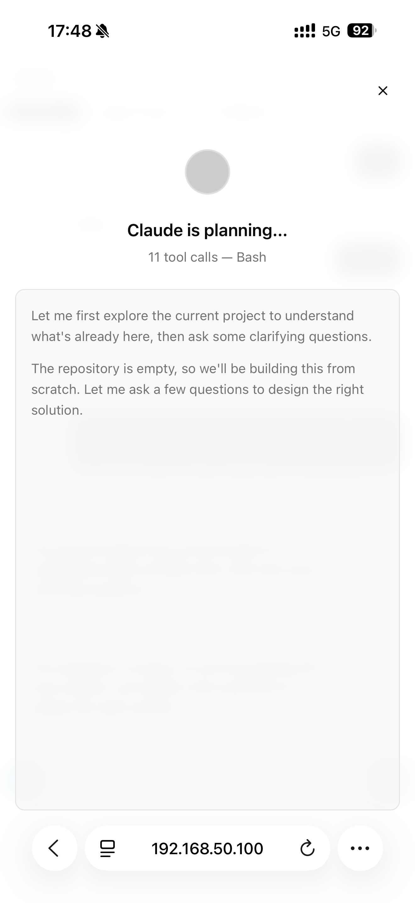
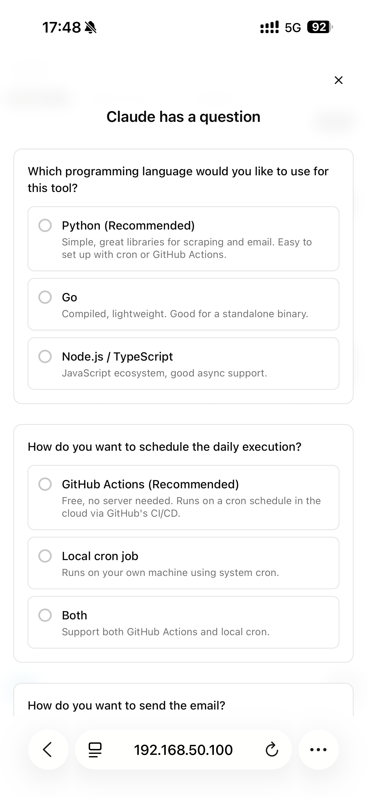
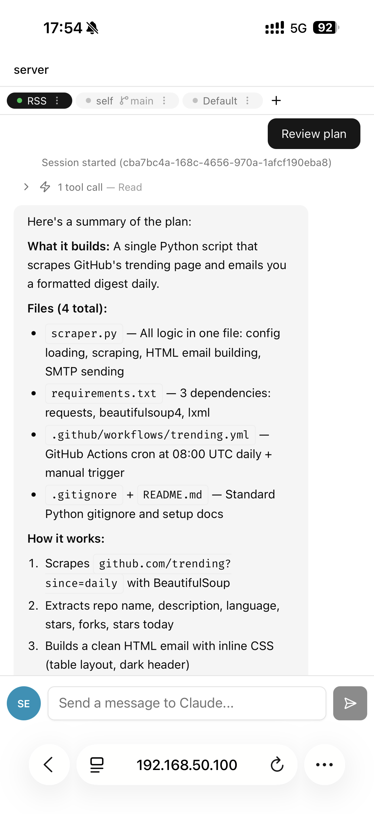
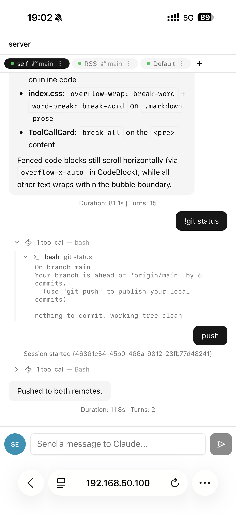

# Gate

任务工作台重构进度见[实施规划](docs/refactor-plan.md)。修改前请阅读 [LESSONS.md](LESSONS.md)，
并记录已验证的问题、原因和预防方法。每个完成的重构步骤分别验证并提交。
[Runtime 验证工具](tools/runtime-probe/README.md)用于验证独立运行和 SSH 事件恢复，
使用隔离数据验证 `server/runtime/` 中的托管运行时；现有 Sessions 继续使用原来的后端连接方式。
新的项目、工作副本、任务和执行记录与旧数据并存；迁移保留聊天历史，仅导入明确的任务目标，
无法确认任务归属的会话继续保留在原有工作区中。
默认首页已切换为任务工作台：按交付状态查看任务，在 Projects 中管理仓库和不同机器上的工作副本，
每个任务分别保存目标、验收条件和 agent 选择。原有聊天通过 Sessions 入口访问。
任务页面现在支持安装远端 Runtime、启动执行、读取日志和请求停止。默认使用独立 worktree，
后端重启或 SSH 重连后补齐事件，只有确认进程退出后才释放工作目录锁；执行成功仍需人工验收任务。
P3 已加入待处理事项：审批、提问、失败和回答记录会跨页面同步，冲突回答会被拒绝。
任务结果页面支持查看变更、执行测试、记录执行前后的代码快照与实际退出码，并下载完整日志。
旧测试证据与当前代码不一致时会显示提示，测试通过不会自动验收任务。
任务支持把目标、验收条件、上一轮结果和测试证据交接给另一个 agent。
独立审查使用固定代码快照和单独的 worktree；任务可以继续修改，页面会提示审查版本是否过期。
可按工作副本安装 Claude/Codex hook，查看外部会话的最近活动并关联任务，同目录占用会阻止 Gate 启动新任务。
外部会话仍在原生终端中控制；Codex hook 需要在原生工具中审阅并信任，Gate 不会自动授权。
任务内可启动持久化原生终端，在浏览器中输入、调整窗口、分离和重新连接；关闭页面不会结束远端执行。
同一终端由一个浏览器控制输入，其他页面只读。远端终端要求 Linux 和支持 pidfd 的 Python 3.9+。
项目设置可保存新任务的默认 agent、工作副本和隔离方式，已有任务保持原设置。
任务内可预览并执行来自 `gate.json` 或项目覆盖项的 setup/run/test 脚本，保存命令、日志、代码快照和退出码。
setup、run 记录会与测试证据明确区分；命令变更后必须重新查看，重复请求不会重新执行。
配置步骤、已验证行为和限制见[托管执行说明](docs/managed-execution.md)。

[English](README.md) | [中文](README_CN.md)

**Gate** 为远程服务器上的 AI 编程 CLI（[Claude Code](https://docs.anthropic.com/en/docs/claude-code)、[OpenAI Codex](https://github.com/openai/codex)）打开一扇门 — 随时随地，任何设备上编程。

排队、沙发上、地铁里 — 掏出手机，接上之前的工作。Gate 通过 SSH 将浏览器连接到远程 CLI 会话，你的编程环境触手可及。

```
浏览器 (React) <--WebSocket--> Node.js 后端 <--SSH--> 远程服务器
                                     |
                               Provider Layer
                              Claude / Codex / ...
```

## 示例

<table align="center">
  <tr>
    <td align="center"><br/><em>计划模式</em></td>
    <td align="center"><br/><em>交互式提问</em></td>
  </tr>
  <tr>
    <td align="center"><br/><em>与 Claude 对话</em></td>
    <td align="center"><br/><em>命令执行</em></td>
  </tr>
</table>

## 核心特性

- **随时随地编程** — 在电脑上开始，手机上继续。会话通过 SSH 和 CLI resume 跨设备持久化。
- **接入已有会话** — 已经在终端跑 CLI 了？Gate 能找到它的日志并从断点处恢复。
- **清爽的聊天界面** — 终端输出解析为 Markdown 消息，可折叠的工具调用卡片，语法高亮代码块，可滚动表格。
- **多服务器、多会话** — 管理多台远程服务器，每台多个会话。滑动或点击切换。
- **Workspace Command Center** — 仓库是一级工作区，按 backlog、in-progress、review、done、canceled 分组管理，可置顶、归档、继续工作。
- **简洁的 Workspace 总览** — 每个工作区展示聚焦的 Start composer、展开的 session 列表、server/branch/worktree 摘要、变更文件数量和按需工具入口。
- **Workspace Start 流程** — 从一个目标 prompt 开始，选择 Claude 或 Codex，并在启动 CLI 前使用当前分支、切换分支、新建分支，或选择当前/新建/已有 worktree。
- **Workspace Inspector** — 按需打开的右侧固定工具栏，以 workspace 为上下文查看变更、计划、仓库脚本、一次性终端命令和交付动作。
- **仓库脚本与交付动作** — 可通过可选 `gate.json` 配置 `setup`、`run`、`test` 脚本并经 SSH 运行；Inspector 中可生成 commit message、commit and push、push、创建 PR、标记 review/done/canceled。
- **实时计划追踪** — 从 Claude 输出中自动提取 checklist 到侧边面板。勾选步骤、编辑计划、发送执行。
- **日志同步** — 通过同步远程 CLI 会话的日志，追上在 Gate 之外完成的工作。
- **全平台响应式** — 桌面三栏布局，平板抽屉模式，手机底部弹出和滑动手势。支持刘海屏。
- **多 CLI 支持** — 支持 Claude Code 和 OpenAI Codex CLI。会话内可切换 CLI 工具，自动同步上下文。切换回之前的工具时自动恢复原有对话，不会创建新会话。
- **切换对话** — 在同一会话内新建 CLI 对话或恢复之前的对话。消息按 CLI 会话隔离，切换后展示干净的视图。
- **持久化历史** — SQLite 存储聊天记录，断线重连和服务器重启都不会丢失。

## 快速开始

### 前置条件

- Node.js >= 20
- 一台有 SSH 访问权限的远程服务器，至少安装以下之一：
  - [Claude Code CLI](https://docs.anthropic.com/en/docs/claude-code) — 在服务器上运行一次 `claude` 完成认证
  - [OpenAI Codex CLI](https://github.com/openai/codex) — 在服务器上运行一次 `codex` 完成认证

### 通过 npm 安装（推荐）

```bash
npm i -g @marukohe/gate
gate
```

在浏览器中打开 `http://localhost:3030`。数据存储在 `~/.gate/`。

CLI 选项：

```bash
gate --port 8080          # 自定义端口（默认 3030）
gate --host 127.0.0.1     # 绑定地址（默认 0.0.0.0）
gate --data-dir /my/data  # 自定义数据目录（默认 ~/.gate）
```

### 添加服务器

打开应用 → 点击 **Add Server** → 填入 SSH 凭据（密码或私钥）。可设置新会话的默认工作目录。

## 开发

### 设置

```bash
git clone https://github.com/Marukohe/Gate.git gate
cd gate
npm install
npm run dev
```

客户端运行在 `http://localhost:5173`（API/WS 代理到 3030 端口的服务端）。

### 脚本

| 命令 | 说明 |
|------|------|
| `npm run dev` | 同时启动客户端和服务端 |
| `npm run dev:client` | 仅启动 Vite 开发服务器（5173 端口） |
| `npm run dev:server` | 仅启动 Express + WS 服务端（3030 端口） |
| `npm run build` | 构建客户端和服务端 |
| `npm run start` | 启动生产环境服务端 |
| `cd server && npx vitest run` | 运行服务端测试 |
| `cd server && npx tsc --noEmit` | 服务端类型检查 |

## 项目结构

```
gate/
├── client/                      # React 前端
│   └── src/
│       ├── components/
│       │   ├── chat/            # ChatView, SessionBar, MessageBubble, ToolActivityBlock,
│       │   │                    # ChatInput, ProviderSwitcher, ResumeChatDialog, BranchSwitcher
│       │   ├── layout/          # AppShell, Sidebar, TopBar
│       │   ├── plan/            # PlanPanel, PlanStepItem
│       │   ├── plan-mode/       # PlanModeOverlay, PlanModeQuestion, PlanModeThinking
│       │   ├── server/          # ServerDialog
│       │   ├── workspace/       # WorkspaceHome, WorkspaceStart, WorkspaceInspector, WorkspaceActionBar
│       │   └── ui/              # shadcn/ui 组件
│       ├── hooks/               # use-websocket, use-swipe
│       ├── stores/              # Zustand stores (server, session, chat, git, plan, workspace, ui)
│       └── lib/                 # 工具函数 (plan-parser, provider-colors, server-utils, notification)
├── server/                      # Node.js 后端
│   └── src/
│       ├── index.ts             # Express 入口
│       ├── db.ts                # SQLite (servers, sessions, messages)
│       ├── ssh-manager.ts       # SSH 连接池 + CLI 通道管理
│       ├── ssh-browse.ts        # 远程目录浏览
│       ├── repo-scripts.ts      # 可选 gate.json 脚本解析
│       ├── git-utils.ts         # Git 命令辅助函数
│       ├── workspace-actions.ts # Workspace 交付动作状态
│       ├── workspace-inspector.ts # Workspace Inspector 快照
│       ├── ws-handler.ts        # WebSocket 服务端
│       ├── routes/              # REST API
│       ├── providers/
│       │   ├── types.ts         # CLIProvider 接口, OutputParser, ParsedMessage
│       │   ├── registry.ts      # Provider 注册与查找
│       │   ├── claude/          # Claude Code CLI provider
│       │   └── codex/           # OpenAI Codex CLI provider
│       └── __tests__/           # Vitest 测试套件
└── docs/                        # 设计文档
```

## 技术栈

**客户端：** Vite · React 19 · TypeScript · Tailwind CSS · shadcn/ui · Zustand

**服务端：** Express 5 · ws · ssh2 · better-sqlite3 · TypeScript

**测试：** Vitest

## WebSocket 协议

客户端 → 服务端：
```jsonc
{ "type": "connect" | "input" | "disconnect", "serverId": "...", "sessionId": "...", "text": "..." }
{ "type": "switch-provider", "serverId": "...", "sessionId": "...", "provider": "codex" }
{ "type": "reset-conversation" | "resume-cli-session", "serverId": "...", "sessionId": "...", "claudeSessionId": "..." }
{ "type": "list-cli-sessions", "serverId": "...", "workingDir": "...", "provider": "claude" }
{ "type": "exec", "serverId": "...", "sessionId": "...", "workspaceId": "...", "command": "git status", "terminal": true, "requestId": "..." }
{ "type": "list-workspaces" | "create-workspace" | "update-workspace" | "delete-workspace", "workspaceId": "...", ... }
{ "type": "start-workspace-task", "workspaceId": "...", "goal": "...", "provider": "claude", "branchMode": "create", "worktreeMode": "isolated" }
{ "type": "fetch-workspace-inspector" | "run-workspace-script" | "run-workspace-action", "workspaceId": "...", ... }
```

服务端 → 客户端：
```jsonc
{ "type": "message" | "status" | "history" | "sessions" | "git-info", "serverId": "...", ... }
{ "type": "cli-sessions", "serverId": "...", "sessions": ["..."] }
{ "type": "exec-result", "workspaceId": "...", "requestId": "...", "stdout": "...", "stderr": "...", "exitCode": 0 }
{ "type": "workspace-list" | "workspace-update" | "workspace-deleted" | "workspace-task-started", "workspaceId": "...", ... }
{ "type": "workspace-inspector" | "workspace-run-result" | "workspace-action-result", "workspaceId": "...", ... }
```

## 响应式布局

| 断点 | 布局 |
|------|------|
| 桌面（≥1024px） | Sidebar + workspace/chat + 按需打开的固定 Inspector |
| 平板（768–1023px） | Workspace/chat 全宽，sidebar/inspector 使用抽屉 |
| 手机（<768px） | Workspace/chat 全屏，server 和 inspector 使用底部弹出 |

## 为什么叫 "Gate"？

取自《命运石之门》(*Steins;Gate*) — 那部消息穿越时间改变世界线的动画。在这里，你的消息通过 SSH 穿越到远程服务器上的 Claude，为你的任何设备和编程环境之间打开一扇门。

## 许可证

MIT
